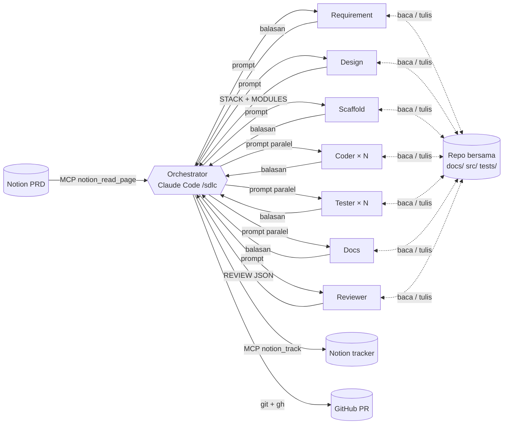
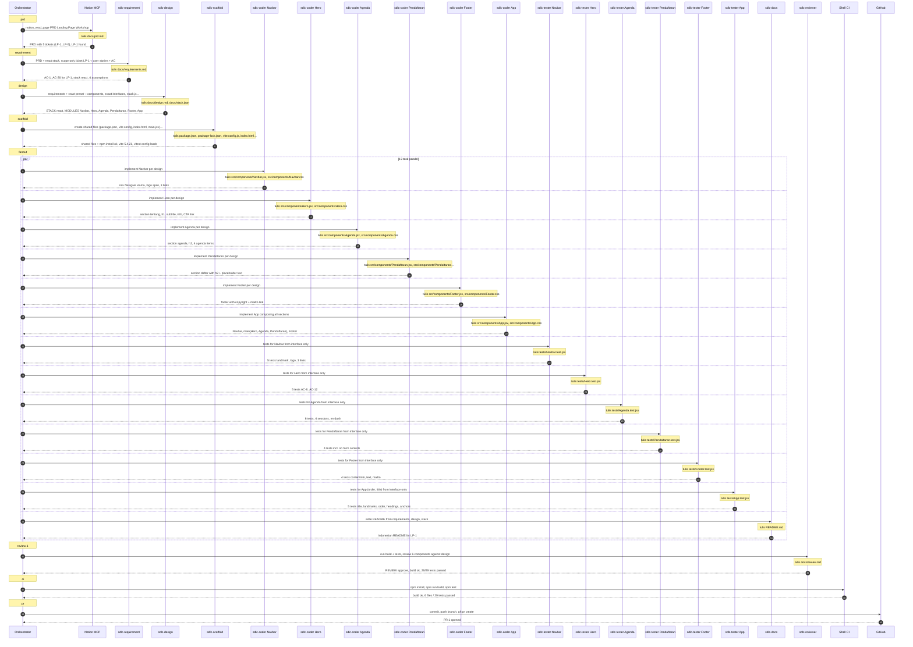

# Komunikasi Agent — LP-1 (sdlc-20261015-2118-lp-1)

## Topologi

Komunikasi antar-agent memakai tiga saluran:

1. **Message passing (prompt dan balasan).** Orchestrator mengirim prompt berisi tugas ke tiap subagent, lalu subagent membalas dengan ringkasan dan baris terstruktur seperti `MODULES: [...]` atau `REVIEW: {...}`. Subagent tidak pernah berbicara langsung satu sama lain. Topologinya *hub-and-spoke*, dengan orchestrator sebagai koordinator tunggal.
2. **Shared repository (blackboard).** Hasil kerja ditulis ke repo bersama: `docs/requirements.md`, `docs/design.md`, `docs/stack.json`, `src/`, `tests/`. Agent berikutnya membaca file tersebut. Interface di `docs/design.md` berfungsi sebagai *kontrak*, sehingga Coder dan Tester untuk modul yang sama bisa bekerja paralel tanpa saling berkomunikasi.
3. **Tool / MCP.** Hanya orchestrator yang menulis ke Notion (tracker dan laporan) lewat MCP, serta ke git dan GitHub. Dengan satu penulis untuk keduanya, tidak ada konflik penulisan bersamaan.

Paralelisme terjadi pada fase *fan-out*. Setelah Design membagi sistem menjadi modul yang independen, semua Coder, Tester dan Docs dijalankan sekaligus dalam satu pesan. Batas speedup ditentukan oleh rantai fase yang harus berurutan (Requirement → Design → Scaffold → Fan-out → Review → CI → PR), sesuai hukum Amdahl.

## Metrik paralelisme

| Metrik | Nilai |
|---|---|
| Makespan (wall-clock seluruh run) | 477 s |
| Total waktu kerja semua task (jika dijalankan berurutan) | 634 s |
| Speedup terhadap eksekusi berurutan | 1.33× |
| Average parallelism (kerja ÷ makespan) | 1.33 |
| Maksimum agent berjalan bersamaan | 13 |
| Fase paling paralel: fanout | 13 task, 278 s kerja dalam 26 s → 10.64× |
| Jumlah subagent yang dijalankan | 17 |
| Jumlah pesan (prompt + balasan) | 40 |
| File bersama yang ditulis agent | 32 |
| Overhead koordinasi (jeda antar-fase di orchestrator) | 95 s (20%) |
| Retry / task gagal | 0 / 0 |

## Diagram urutan pesan

## Timeline

```mermaid
gantt
    title Timeline eksekusi agent
    dateFormat HH:mm:ss
    axisFormat %H:%M:%S
    section prd
    prd :21:18:15, 21:18:26
    section requirement
    requirement :21:18:26, 21:19:21
    section design
    design :21:19:21, 21:20:58
    section scaffold
    scaffold :21:20:58, 21:22:17
    section fanout
    code,Navbar :21:22:55, 21:23:16
    code,Hero :21:22:55, 21:23:14
    code,Agenda :21:22:55, 21:23:17
    code,Pendaftaran :21:22:55, 21:23:21
    code,Footer :21:22:55, 21:23:13
    code,App :21:22:55, 21:23:14
    test,Navbar :21:22:55, 21:23:17
    test,Hero :21:22:55, 21:23:13
    test,Agenda :21:22:55, 21:23:16
    test,Pendaftaran :21:22:55, 21:23:13
    test,Footer :21:22:55, 21:23:15
    test,App :21:22:55, 21:23:21
    docs :21:22:55, 21:23:16
    section review-1
    review :21:24:18, 21:25:22
    section ci
    ci :21:25:22, 21:25:43
    section pr
    pr :21:25:43, 21:26:12
```

## Log pesan

| # | Waktu | Fase | Task | Dari → Ke | Isi | Durasi |
|---|---|---|---|---|---|---|
| 1 | 21:18:15 | prd | prd | orchestrator → Notion MCP | notion_read_page PRD Landing Page Workshop | |
| 2 | 21:18:26 | prd | prd | Notion MCP → orchestrator | ok: PRD with 5 tickets (LP-1..LP-5), LP-1 found (file: docs/prd.md) | 11.0 s |
| 3 | 21:18:26 | requirement | requirement | orchestrator → sdlc-requirement | PRD + react stack, scope only ticket LP-1 -› user stories + AC | |
| 4 | 21:19:21 | requirement | requirement | sdlc-requirement → orchestrator | ok: AC-1..AC-26 for LP-1, stack react, 4 assumptions (file: docs/requirements.md) | 55.0 s |
| 5 | 21:19:21 | design | design | orchestrator → sdlc-design | requirements + react preset -› components, exact interfaces, stack.json | |
| 6 | 21:20:58 | design | design | sdlc-design → orchestrator | ok: STACK react, MODULES Navbar, Hero, Agenda, Pendaftaran, Footer, App (file: docs/design.md, docs/stack.json) | 97.0 s |
| 7 | 21:20:58 | scaffold | scaffold | orchestrator → sdlc-scaffold | create shared files (package.json, vite config, index.html, main.jsx) + npm install | |
| 8 | 21:22:17 | scaffold | scaffold | sdlc-scaffold → orchestrator | ok: shared files + npm install ok, vite 5.4.21, vitest config loads (file: package.json, package-lock.json, vite.config.js, index.html, src/main.jsx, src/index.css, tests/setup.js, .gitignore) | 79.0 s |
| 9 | 21:22:55 | fanout | code:Navbar | orchestrator → sdlc-coder Navbar | implement Navbar per design | |
| 10 | 21:23:16 | fanout | code:Navbar | sdlc-coder Navbar → orchestrator | ok: nav Navigasi utama, logo span, 3 links (file: src/components/Navbar.jsx, src/components/Navbar.css) | 21.8 s |
| 11 | 21:22:55 | fanout | code:Hero | orchestrator → sdlc-coder Hero | implement Hero per design | |
| 12 | 21:23:14 | fanout | code:Hero | sdlc-coder Hero → orchestrator | ok: section tentang, h1, subtitle, info, CTA link (file: src/components/Hero.jsx, src/components/Hero.css) | 19.6 s |
| 13 | 21:22:55 | fanout | code:Agenda | orchestrator → sdlc-coder Agenda | implement Agenda per design | |
| 14 | 21:23:17 | fanout | code:Agenda | sdlc-coder Agenda → orchestrator | ok: section agenda, h2, 4 agenda items (file: src/components/Agenda.jsx, src/components/Agenda.css) | 22.4 s |
| 15 | 21:22:55 | fanout | code:Pendaftaran | orchestrator → sdlc-coder Pendaftaran | implement Pendaftaran per design | |
| 16 | 21:23:21 | fanout | code:Pendaftaran | sdlc-coder Pendaftaran → orchestrator | ok: section daftar with h2 + placeholder text (file: src/components/Pendaftaran.jsx, src/components/Pendaftaran.css) | 26.0 s |
| 17 | 21:22:55 | fanout | code:Footer | orchestrator → sdlc-coder Footer | implement Footer per design | |
| 18 | 21:23:13 | fanout | code:Footer | sdlc-coder Footer → orchestrator | ok: footer with copyright + mailto link (file: src/components/Footer.jsx, src/components/Footer.css) | 18.4 s |
| 19 | 21:22:55 | fanout | code:App | orchestrator → sdlc-coder App | implement App composing all sections | |
| 20 | 21:23:14 | fanout | code:App | sdlc-coder App → orchestrator | ok: Navbar, main(Hero, Agenda, Pendaftaran), Footer (file: src/components/App.jsx, src/components/App.css) | 19.9 s |
| 21 | 21:22:55 | fanout | test:Navbar | orchestrator → sdlc-tester Navbar | tests for Navbar from interface only | |
| 22 | 21:23:17 | fanout | test:Navbar | sdlc-tester Navbar → orchestrator | ok: 5 tests landmark, logo, 3 links (file: tests/Navbar.test.jsx) | 22.5 s |
| 23 | 21:22:55 | fanout | test:Hero | orchestrator → sdlc-tester Hero | tests for Hero from interface only | |
| 24 | 21:23:13 | fanout | test:Hero | sdlc-tester Hero → orchestrator | ok: 5 tests AC-8..AC-12 (file: tests/Hero.test.jsx) | 18.8 s |
| 25 | 21:22:55 | fanout | test:Agenda | orchestrator → sdlc-tester Agenda | tests for Agenda from interface only | |
| 26 | 21:23:16 | fanout | test:Agenda | sdlc-tester Agenda → orchestrator | ok: 6 tests, 4 sessions, en dash (file: tests/Agenda.test.jsx) | 21.5 s |
| 27 | 21:22:55 | fanout | test:Pendaftaran | orchestrator → sdlc-tester Pendaftaran | tests for Pendaftaran from interface only | |
| 28 | 21:23:13 | fanout | test:Pendaftaran | sdlc-tester Pendaftaran → orchestrator | ok: 4 tests incl. no form controls (file: tests/Pendaftaran.test.jsx) | 18.9 s |
| 29 | 21:22:55 | fanout | test:Footer | orchestrator → sdlc-tester Footer | tests for Footer from interface only | |
| 30 | 21:23:15 | fanout | test:Footer | sdlc-tester Footer → orchestrator | ok: 4 tests contentinfo, text, mailto (file: tests/Footer.test.jsx) | 20.1 s |
| 31 | 21:22:55 | fanout | test:App | orchestrator → sdlc-tester App | tests for App (order, title) from interface only | |
| 32 | 21:23:21 | fanout | test:App | sdlc-tester App → orchestrator | ok: 5 tests title, landmarks, order, headings, anchors (file: tests/App.test.jsx) | 26.1 s |
| 33 | 21:22:55 | fanout | docs | orchestrator → sdlc-docs | write README from requirements, design, stack | |
| 34 | 21:23:16 | fanout | docs | sdlc-docs → orchestrator | ok: Indonesian README for LP-1 (file: README.md) | 22.0 s |
| 35 | 21:24:18 | review-1 | review | orchestrator → sdlc-reviewer | run build + tests, review 6 components against design | |
| 36 | 21:25:22 | review-1 | review | sdlc-reviewer → orchestrator | ok: REVIEW approve, build ok, 29/29 tests passed (file: docs/review.md) | 64.0 s |
| 37 | 21:25:22 | ci | ci | orchestrator → Shell CI | npm install, npm run build, npm test | |
| 38 | 21:25:43 | ci | ci | Shell CI → orchestrator | ok: build ok, 6 files / 29 tests passed | 21.0 s |
| 39 | 21:25:43 | pr | pr | orchestrator → GitHub | commit, push branch, gh pr create | |
| 40 | 21:26:12 | pr | pr | GitHub → orchestrator | ok: PR 1 opened | 29.0 s |
