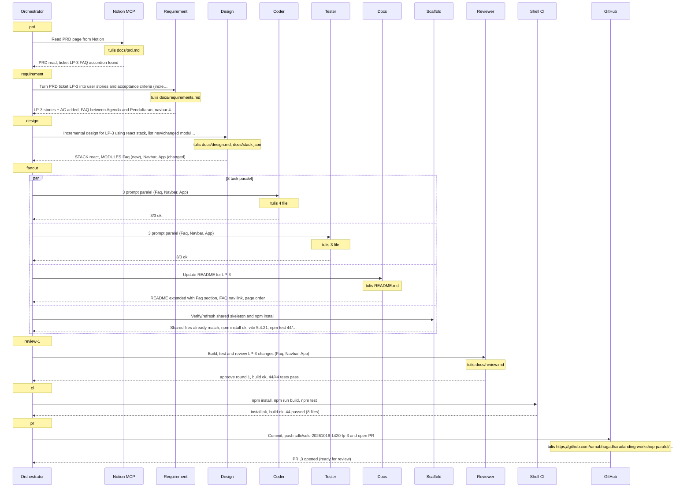

# Komunikasi Agent — LP-3 (sdlc-20261016-1420-lp-3)

## Topologi

Komunikasi antar-agent memakai tiga saluran:

1. **Message passing (prompt dan balasan).** Orchestrator mengirim prompt berisi tugas ke tiap subagent, lalu subagent membalas dengan ringkasan dan baris terstruktur seperti `MODULES: [...]` atau `REVIEW: {...}`. Subagent tidak pernah berbicara langsung satu sama lain. Topologinya *hub-and-spoke*, dengan orchestrator sebagai koordinator tunggal.
2. **Shared repository (blackboard).** Hasil kerja ditulis ke repo bersama: `docs/requirements.md`, `docs/design.md`, `docs/stack.json`, `src/`, `tests/`. Agent berikutnya membaca file tersebut. Interface di `docs/design.md` berfungsi sebagai *kontrak*, sehingga Coder dan Tester untuk modul yang sama bisa bekerja paralel tanpa saling berkomunikasi.
3. **Tool / MCP.** Hanya orchestrator yang menulis ke Notion (tracker dan laporan) lewat MCP, serta ke git dan GitHub. Dengan satu penulis untuk keduanya, tidak ada konflik penulisan bersamaan.

Paralelisme terjadi pada fase *fan-out*. Setelah Design membagi sistem menjadi modul yang independen, Scaffold, semua Coder, Tester dan Docs dijalankan sekaligus dalam satu pesan; Scaffold tidak ditunggu karena agent lain hanya membaca `docs/`. Batas speedup ditentukan oleh rantai fase yang harus berurutan (Requirement → Design → Fan-out → Review → CI → PR), sesuai hukum Amdahl.

## Metrik paralelisme

| Metrik | Nilai |
|---|---|
| Makespan (wall-clock seluruh run) | 446 s |
| Total waktu kerja semua task (jika dijalankan berurutan) | 585 s |
| Speedup terhadap eksekusi berurutan | 1.31× |
| Average parallelism (kerja ÷ makespan) | 1.31 |
| Maksimum agent berjalan bersamaan | 8 |
| Fase paling paralel: fanout | 8 task, 225 s kerja dalam 78 s → 2.88× |
| Efisiensi fase fanout (speedup ÷ jumlah agent) | 36% |
| Batas speedup menurut hukum Amdahl (agent tak terbatas) | 1.63× |
| Jumlah subagent yang dijalankan | 11 |
| Jumlah pesan (prompt + balasan) | 28 |
| File bersama yang ditulis agent | 14 |
| Overhead koordinasi (jeda antar-fase di orchestrator) | 8 s (2%) |
| Retry / task gagal | 0 / 0 |

## Diagram urutan pesan

## Timeline

```mermaid
gantt
    title Timeline eksekusi agent
    dateFormat HH:mm:ss
    axisFormat %H:%M
    section prd
    Notion MCP :active, 14:20:16, 14:20:44
    section requirement
    Requirement :active, 14:20:44, 14:22:16
    section design
    Design :active, 14:22:16, 14:24:40
    section fanout
    Coder ×3 :14:24:40, 14:25:00
    Tester ×3 :14:24:40, 14:25:07
    Docs :14:24:40, 14:25:08
    Scaffold :14:24:40, 14:25:58
    section review-1
    Reviewer :active, 14:25:58, 14:26:59
    section ci
    Shell CI :active, 14:26:59, 14:27:10
    section pr
    GitHub :active, 14:27:19, 14:27:42
    section jeda
    jeda 8 s :done, 14:27:10, 14:27:19
```

## Log pesan

| # | Waktu | Fase | Task | Dari → Ke | Isi | Durasi |
|---|---|---|---|---|---|---|
| 1 | 14:20:16 | prd | prd | orchestrator → Notion MCP | Read PRD page from Notion | |
| 2 | 14:20:44 | prd | prd | Notion MCP → orchestrator | ok: PRD read, ticket LP-3 FAQ accordion found (file: docs/prd.md) | 28.0 s |
| 3 | 14:20:44 | requirement | requirement | orchestrator → sdlc-requirement | Turn PRD ticket LP-3 into user stories and acceptance criteria (incremental) | |
| 4 | 14:22:16 | requirement | requirement | sdlc-requirement → orchestrator | ok: LP-3 stories + AC added, FAQ between Agenda and Pendaftaran, navbar 4 links (file: docs/requirements.md) | 92.0 s |
| 5 | 14:22:16 | design | design | orchestrator → sdlc-design | Incremental design for LP-3 using react stack, list new/changed modules | |
| 6 | 14:24:40 | design | design | sdlc-design → orchestrator | ok: STACK react, MODULES Faq (new), Navbar, App (changed) (file: docs/design.md, docs/stack.json) | 144.0 s |
| 7 | 14:24:40 | fanout | code:Faq | orchestrator → sdlc-coder Faq | Implement new Faq accordion module | |
| 8 | 14:24:59 | fanout | code:Faq | sdlc-coder Faq → orchestrator | ok: Faq.jsx (FAQ_ITEMS, single-open accordion) and Faq.css written (file: src/components/Faq.jsx, src/components/Faq.css) | 19.9 s |
| 9 | 14:24:40 | fanout | code:Navbar | orchestrator → sdlc-coder Navbar | Add FAQ link to Navbar | |
| 10 | 14:25:00 | fanout | code:Navbar | sdlc-coder Navbar → orchestrator | ok: FAQ link added between Agenda and Daftar (file: src/components/Navbar.jsx) | 20.0 s |
| 11 | 14:24:40 | fanout | code:App | orchestrator → sdlc-coder App | Render Faq between Agenda and Pendaftaran | |
| 12 | 14:24:51 | fanout | code:App | sdlc-coder App → orchestrator | ok: App imports Faq and renders it between Agenda and Pendaftaran (file: src/components/App.jsx) | 11.6 s |
| 13 | 14:24:40 | fanout | test:Faq | orchestrator → sdlc-tester Faq | Write tests/Faq.test.jsx | |
| 14 | 14:25:07 | fanout | test:Faq | sdlc-tester Faq → orchestrator | ok: 6 Faq tests, structure, content, single-open behaviour, items prop (file: tests/Faq.test.jsx) | 27.5 s |
| 15 | 14:24:40 | fanout | test:Navbar | orchestrator → sdlc-tester Navbar | Update tests/Navbar.test.jsx for 4 links | |
| 16 | 14:24:55 | fanout | test:Navbar | sdlc-tester Navbar → orchestrator | ok: Navbar tests updated for 4 links incl. FAQ -› ,faq (file: tests/Navbar.test.jsx) | 15.2 s |
| 17 | 14:24:40 | fanout | test:App | orchestrator → sdlc-tester App | Update tests/App.test.jsx for new order/headings | |
| 18 | 14:25:04 | fanout | test:App | sdlc-tester App → orchestrator | ok: App tests updated, order, headings, links, FAQ collapsed (file: tests/App.test.jsx) | 24.2 s |
| 19 | 14:24:40 | fanout | docs | orchestrator → sdlc-docs | Update README for LP-3 | |
| 20 | 14:25:08 | fanout | docs | sdlc-docs → orchestrator | ok: README extended with Faq section, FAQ nav link, page order (file: README.md) | 28.4 s |
| 21 | 14:24:40 | fanout | scaffold | orchestrator → sdlc-scaffold | Verify/refresh shared skeleton and npm install | |
| 22 | 14:25:58 | fanout | scaffold | sdlc-scaffold → orchestrator | ok: Shared files already match, npm install ok, vite 5.4.21, npm test 44/44 | 78.0 s |
| 23 | 14:25:58 | review-1 | review | orchestrator → sdlc-reviewer | Build, test and review LP-3 changes (Faq, Navbar, App) | |
| 24 | 14:26:59 | review-1 | review | sdlc-reviewer → orchestrator | ok: approve round 1, build ok, 44/44 tests pass (file: docs/review.md) | 61.0 s |
| 25 | 14:26:59 | ci | ci | orchestrator → Shell CI | npm install, npm run build, npm test | |
| 26 | 14:27:10 | ci | ci | Shell CI → orchestrator | ok: install ok, build ok, 44 passed (8 files) | 11.7 s |
| 27 | 14:27:19 | pr | pr | orchestrator → GitHub | Commit, push sdlc/sdlc-20261016-1420-lp-3 and open PR | |
| 28 | 14:27:42 | pr | pr | GitHub → orchestrator | ok: PR ,3 opened (ready for review) (file: https://github.com/ramabhagadhara/landing-workshop-paralel/pull/3) | 23.0 s |
