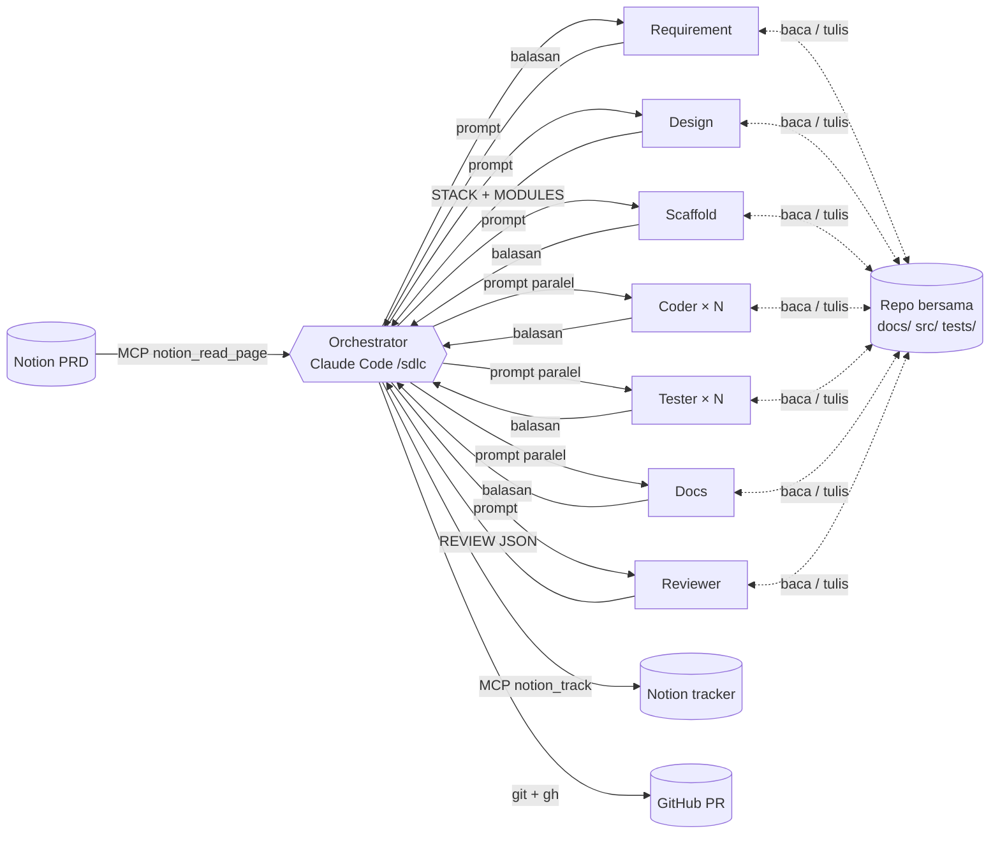
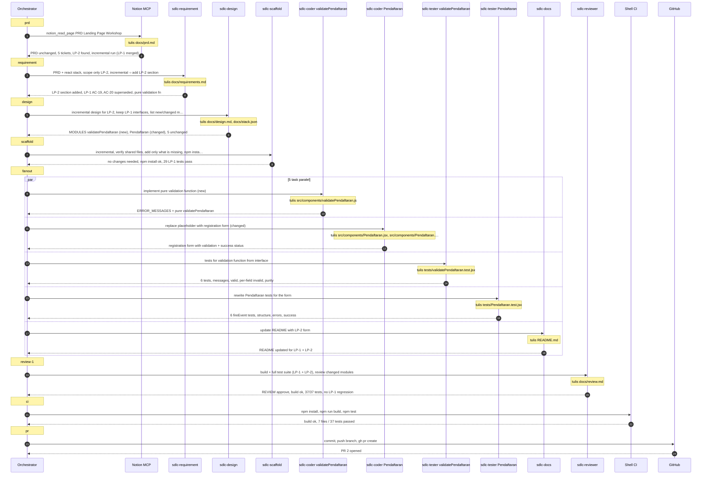

# Komunikasi Agent — LP-2 (sdlc-20261015-2144-lp-2)

## Topologi

Komunikasi antar-agent memakai tiga saluran:

1. **Message passing (prompt dan balasan).** Orchestrator mengirim prompt berisi tugas ke tiap subagent, lalu subagent membalas dengan ringkasan dan baris terstruktur seperti `MODULES: [...]` atau `REVIEW: {...}`. Subagent tidak pernah berbicara langsung satu sama lain. Topologinya *hub-and-spoke*, dengan orchestrator sebagai koordinator tunggal.
2. **Shared repository (blackboard).** Hasil kerja ditulis ke repo bersama: `docs/requirements.md`, `docs/design.md`, `docs/stack.json`, `src/`, `tests/`. Agent berikutnya membaca file tersebut. Interface di `docs/design.md` berfungsi sebagai *kontrak*, sehingga Coder dan Tester untuk modul yang sama bisa bekerja paralel tanpa saling berkomunikasi.
3. **Tool / MCP.** Hanya orchestrator yang menulis ke Notion (tracker dan laporan) lewat MCP, serta ke git dan GitHub. Dengan satu penulis untuk keduanya, tidak ada konflik penulisan bersamaan.

Paralelisme terjadi pada fase *fan-out*. Setelah Design membagi sistem menjadi modul yang independen, semua Coder, Tester dan Docs dijalankan sekaligus dalam satu pesan. Batas speedup ditentukan oleh rantai fase yang harus berurutan (Requirement → Design → Scaffold → Fan-out → Review → CI → PR), sesuai hukum Amdahl.

## Metrik paralelisme

| Metrik | Nilai |
|---|---|
| Makespan (wall-clock seluruh run) | 559 s |
| Total waktu kerja semua task (jika dijalankan berurutan) | 567 s |
| Speedup terhadap eksekusi berurutan | 1.01× |
| Average parallelism (kerja ÷ makespan) | 1.01 |
| Maksimum agent berjalan bersamaan | 5 |
| Fase paling paralel: fanout | 5 task, 139 s kerja dalam 39 s → 3.59× |
| Jumlah subagent yang dijalankan | 9 |
| Jumlah pesan (prompt + balasan) | 24 |
| File bersama yang ditulis agent | 11 |
| Overhead koordinasi (jeda antar-fase di orchestrator) | 92 s (16%) |
| Retry / task gagal | 0 / 0 |

## Diagram urutan pesan

## Timeline

```mermaid
gantt
    title Timeline eksekusi agent
    dateFormat HH:mm:ss
    axisFormat %H:%M:%S
    section prd
    prd :21:44:46, 21:45:03
    section requirement
    requirement :21:45:03, 21:46:14
    section design
    design :21:46:38, 21:49:26
    section scaffold
    scaffold :21:49:26, 21:50:14
    section fanout
    code,validatePendaftaran :21:50:49, 21:51:01
    code,Pendaftaran :21:50:49, 21:51:23
    test,validatePendaftaran :21:50:49, 21:51:13
    test,Pendaftaran :21:50:49, 21:51:27
    docs :21:50:49, 21:51:17
    section review-1
    review :21:52:01, 21:53:18
    section ci
    ci :21:53:18, 21:53:37
    section pr
    pr :21:53:37, 21:54:05
```

## Log pesan

| # | Waktu | Fase | Task | Dari → Ke | Isi | Durasi |
|---|---|---|---|---|---|---|
| 1 | 21:44:46 | prd | prd | orchestrator → Notion MCP | notion_read_page PRD Landing Page Workshop | |
| 2 | 21:45:03 | prd | prd | Notion MCP → orchestrator | ok: PRD unchanged, 5 tickets, LP-2 found, incremental run (LP-1 merged) (file: docs/prd.md) | 17.0 s |
| 3 | 21:45:03 | requirement | requirement | orchestrator → sdlc-requirement | PRD + react stack, scope only LP-2, incremental -› add LP-2 section | |
| 4 | 21:46:14 | requirement | requirement | sdlc-requirement → orchestrator | ok: LP-2 section added, LP-1 AC-19, AC-20 superseded, pure validation fn (file: docs/requirements.md) | 71.7 s |
| 5 | 21:46:38 | design | design | orchestrator → sdlc-design | incremental design for LP-2, keep LP-1 interfaces, list new/changed modules | |
| 6 | 21:49:26 | design | design | sdlc-design → orchestrator | ok: MODULES validatePendaftaran (new), Pendaftaran (changed), 5 unchanged (file: docs/design.md, docs/stack.json) | 168.0 s |
| 7 | 21:49:26 | scaffold | scaffold | orchestrator → sdlc-scaffold | incremental, verify shared files, add only what is missing, npm install | |
| 8 | 21:50:14 | scaffold | scaffold | sdlc-scaffold → orchestrator | ok: no changes needed, npm install ok, 29 LP-1 tests pass | 48.1 s |
| 9 | 21:50:49 | fanout | code:validatePendaftaran | orchestrator → sdlc-coder validatePendaftaran | implement pure validation function (new) | |
| 10 | 21:51:01 | fanout | code:validatePendaftaran | sdlc-coder validatePendaftaran → orchestrator | ok: ERROR_MESSAGES + pure validatePendaftaran (file: src/components/validatePendaftaran.js) | 12.8 s |
| 11 | 21:50:49 | fanout | code:Pendaftaran | orchestrator → sdlc-coder Pendaftaran | replace placeholder with registration form (changed) | |
| 12 | 21:51:23 | fanout | code:Pendaftaran | sdlc-coder Pendaftaran → orchestrator | ok: registration form with validation + success status (file: src/components/Pendaftaran.jsx, src/components/Pendaftaran.css) | 34.0 s |
| 13 | 21:50:49 | fanout | test:validatePendaftaran | orchestrator → sdlc-tester validatePendaftaran | tests for validation function from interface | |
| 14 | 21:51:13 | fanout | test:validatePendaftaran | sdlc-tester validatePendaftaran → orchestrator | ok: 6 tests, messages, valid, per-field invalid, purity (file: tests/validatePendaftaran.test.jsx) | 24.9 s |
| 15 | 21:50:49 | fanout | test:Pendaftaran | orchestrator → sdlc-tester Pendaftaran | rewrite Pendaftaran tests for the form | |
| 16 | 21:51:27 | fanout | test:Pendaftaran | sdlc-tester Pendaftaran → orchestrator | ok: 6 fireEvent tests, structure, errors, success (file: tests/Pendaftaran.test.jsx) | 38.6 s |
| 17 | 21:50:49 | fanout | docs | orchestrator → sdlc-docs | update README with LP-2 form | |
| 18 | 21:51:17 | fanout | docs | sdlc-docs → orchestrator | ok: README updated for LP-1 + LP-2 (file: README.md) | 28.2 s |
| 19 | 21:52:01 | review-1 | review | orchestrator → sdlc-reviewer | build + full test suite (LP-1 + LP-2), review changed modules | |
| 20 | 21:53:18 | review-1 | review | sdlc-reviewer → orchestrator | ok: REVIEW approve, build ok, 37/37 tests, no LP-1 regression (file: docs/review.md) | 77.0 s |
| 21 | 21:53:18 | ci | ci | orchestrator → Shell CI | npm install, npm run build, npm test | |
| 22 | 21:53:37 | ci | ci | Shell CI → orchestrator | ok: build ok, 7 files / 37 tests passed | 19.0 s |
| 23 | 21:53:37 | pr | pr | orchestrator → GitHub | commit, push branch, gh pr create | |
| 24 | 21:54:05 | pr | pr | GitHub → orchestrator | ok: PR 2 opened | 28.0 s |
